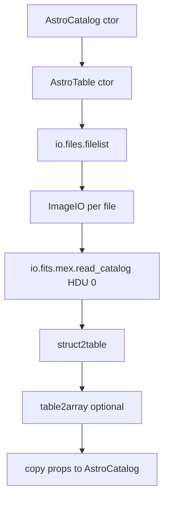
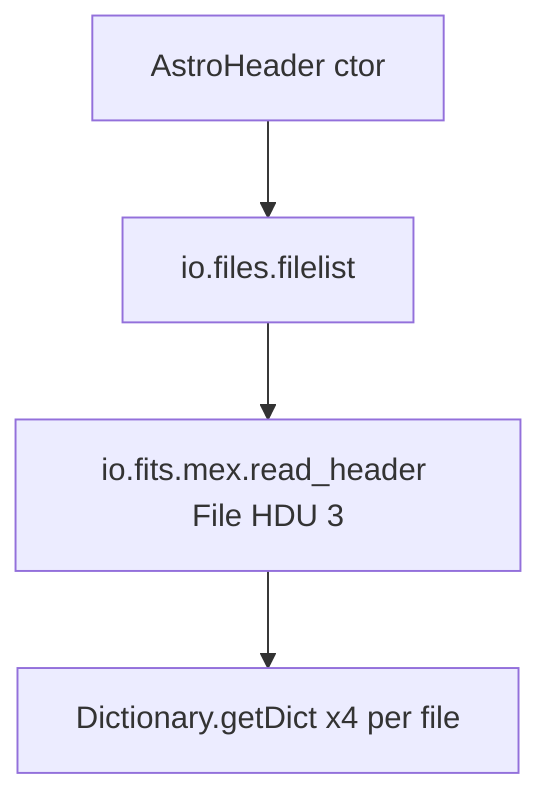

# AstroCatalog and AstroHeader read path (proc ingest)

Reference for how LAST proc catalog ingest reads ~480 `*proc_Cat_1.fits*` files per visit, what costs time, and how to read `insertArchiveCatalogs2DB_perf` log stages.

Production ingest: [`insertArchiveCatalogs2DB.m`](../insertArchiveCatalogs2DB.m). Measurement clone: [`insertArchiveCatalogs2DB_perf.m`](../insertArchiveCatalogs2DB_perf.m).

Typical call (visit directory is current working directory):

```matlab
Cat = AstroCatalog('LAST*proc_Cat_1.fits*', 'UseMex', true);
AH  = AstroHeader('LAST*proc_Cat_1.fits*', 3, 'UseMex', true);
```

File counts and sizes: [folder_file_estimates.md](folder_file_estimates.md). Log format: [logging.md](logging.md).

---

## AstroCatalog: call tree

`AstroCatalog` does **not** read FITS directly. The constructor builds `AstroTable(varargin{:})`, copies non-dependent properties into `AstroCatalog` objects, and sets `DataType = Cat` ([`@AstroCatalog/AstroCatalog.m`](../../../../@AstroCatalog/AstroCatalog.m)).



### Steps (code references)

| Step | Location | Notes |
|------|----------|--------|
| File list | [`AstroTable.m`](../../../../@AstroTable/AstroTable.m) → [`ImageIO.m`](../../../../@ImageIO/ImageIO.m) | `io.files.filelist(Template, 'AddPath', true)`, `UseRegExp` false |
| Per-file loop | `ImageIO` constructor | One `ImageIO.read1` per matched file |
| MEX table read | `ImageIO.read1`, `IsTable` + `UseMex` | `io.fits.mex.read_catalog(FileName, 0)` — HDU **0** = scan FITS for **first table HDU** ([`read_catalog.cpp`](../../../../../util/+io/+fits/+mex/read_catalog.cpp)) |
| MATLAB tables | `AstroTable` | `struct2table`; default `ConvertTable2array=true` → `table2array` when all columns are double |
| Wrapper | `AstroCatalog` ctor | Copy all non-dependent `AstroTable` properties per object |

With **`UseMex` + `IsTable`**, the MEX path uses `read_catalog(..., 0)` and does **not** use the `HDU=1` argument passed through `ImageIO` for data. Non-MEX path uses `FITS.readTable1` with `HDU`.

### Performance notes (AstroCatalog)

- **Many small files:** ~480 opens per visit; latency dominates on NFS and local disk alike.
- **CFITSIO decode:** Reading all columns/rows into double arrays is usually the largest CPU block.
- **Table-HDU header from MEX:** `read_catalog` also returns a header for the table HDU; stored on `ImageIO.Header` but **ingest keywords come from HDU 3** via `AstroHeader` (see below).
- **Property copy:** 480 × property loop — usually small vs MEX.

---

## AstroHeader: call tree (HDU 3)

Separate constructor — **second full pass** over the same file template ([`@AstroHeader/AstroHeader.m`](../../../../@AstroHeader/AstroHeader.m)).



| Step | Notes |
|------|--------|
| Second `filelist` | Same wildcard template as `AstroCatalog` |
| `read_header(File, 3)` | Open FITS again; read **HDU 3** keywords only ([`read_header.cpp`](../../../../../util/+io/+fits/+mex/read_header.cpp)) |
| Dictionaries | `Dictionary.getDict` for synonyms/comments/time keys; cached in persistent `ComponentMap` ([`Dictionary.m`](../../../../../util/@Dictionary/Dictionary.m)) |

### Performance notes (AstroHeader)

- **Second open per file** — no table payload, but open/parse cost remains.
- Often **less wall time than `readAstroCatalog`** when tables have many rows/columns.
- **Future optimization:** `read_catalog` supports optional `hdu_header=3` in one MEX call ([`read_catalog.m`](../../../../../util/+io/+fits/+mex/read_catalog.m)); [`ImageIO.m`](../../../../@ImageIO/ImageIO.m) currently calls only `read_catalog(FileName, 0)`.

---

## Interpreting proc perf log stages

Optional flags on [`insertArchiveCatalogs2DB_perf.m`](../insertArchiveCatalogs2DB_perf.m) (defaults **false**; measure-overhead shells enable them):

| Flag | Log stage | Meaning |
|------|-----------|---------|
| `CatalogFileInventory` | `catalogFileInventory n=… sizeMB=…` | File count and total bytes (MiB) for the visit template |
| `CatalogRawFileRead` | `readCatalogFilesRaw` | `fopen` + `fread` entire file (no CFITSIO), timed |
| (always) | `readAstroCatalog` | Full `AstroCatalog` path above |
| (always) | `readAstroHeader` | Full `AstroHeader` HDU 3 path |
| (inventory or raw) | `catalogReadRates` | `rawMBps`, `catMBps`, `hdrMBps` = Cat `sizeMB` / stage seconds (MiB/s) |
| (run end) | `AVG catalogReadRates` | Mean/med/weighted **rawMBps** over all injected visits in the job |

Stage lines may include inline `mbPerSec=`. **`rawMBps`** ≈ disk + many opens; **`catMBps`** after raw ≈ MEX/MATLAB parse (not a second cold disk pass). Compare **`AVG catalogReadRates`** (especially **rawMBps weighted** and **med**) across hosts — see [hosts_and_matlab.md](hosts_and_matlab.md#cold-compare-disjoint-months-euclid-vs-wrx).

Rough decomposition when **raw read runs before** `readAstroCatalog` (warm page cache for MEX pass):

```text
readCatalogFilesRaw           ≈  open + read all bytes (MATLAB only)
readAstroCatalog − raw        ≈  FITS parse + struct2table/table2array + wrapper
readAstroHeader               ≈  second pass, HDU 3 headers
```

When `CatalogRawFileRead=true`, **visitTotal** and **AVG fullWork** include one extra full read of all Cat FITS per visit.

Measure-overhead drivers: [`run_measure_proc_overhead_wrx80.sh`](../scripts_wrx/run_measure_proc_overhead_wrx80.sh), [`run_measure_proc_overhead_euclid.sh`](../scripts_euclid/run_measure_proc_overhead_euclid.sh). Env: `MEASURE_CATALOG_ASTRO_PERF` (default `1`), inventory/raw default `0` — see [logging.md](logging.md).

---

## Related docs

- [folder_file_estimates.md](folder_file_estimates.md) — static file counts
- [hosts_and_matlab.md](hosts_and_matlab.md) — WRX vs euclid comparison protocol
- [logging.md](logging.md) — `ENV`, banner, and stage lines
