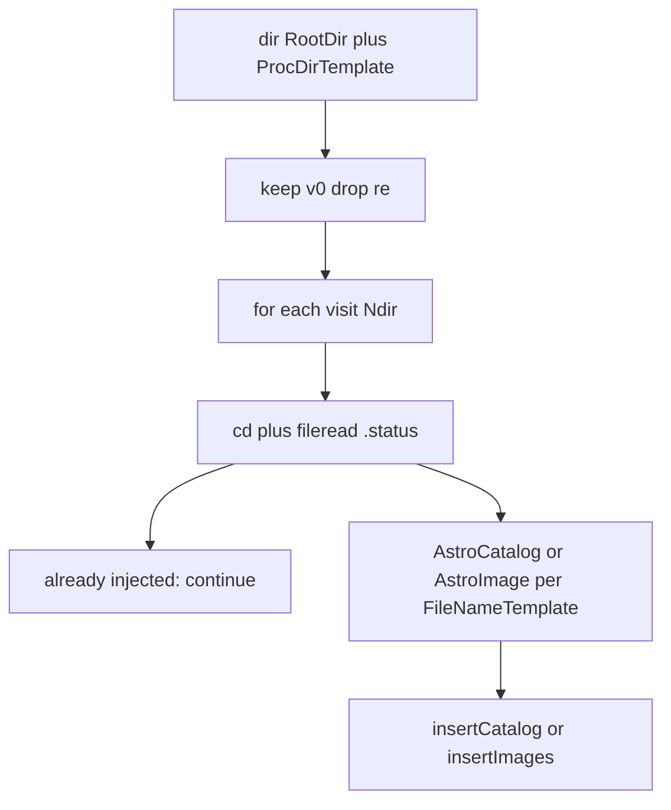

# Archive folder and file estimates (Jan 2026)

Static counts and order-of-magnitude I/O for the four `insertArchive*2DB` scripts on **euclid** `/bigdata2`. Paths below are relative to the repo root and use `/`.

Production cron on **WRX80** uses the same archive path over the network; `dir`, `cd`, and `fileread` there add latency on top of RAID metadata cost.

## Storage

| Item | Value |
|------|--------|
| Host (measurements) | euclid |
| Mount | `/bigdata2/projects/last/data/` |
| Backend | RAID60, WD JBOD102 |

## January 2026 layout (partial month)

Under `LAST.01.01.01/2026/01/` there are **14** day folders (not all calendar days):

06, 07, 09, 11, 12, 15, 17, 18, 19, 20, 23, 24, 25, 28

## Counting commands (euclid)

### Visit folders (all nodes, one month)

One `*v0` directory per visit under `proc/`:

```bash
find /bigdata2/projects/last/data/LAST.01.*.*/2026/01/*/proc/ \
  -mindepth 1 -maxdepth 1 -printf '.' | wc -c
```

**Result:** `30747` visit folders.

### Files (one node, 14 days)

```bash
find /bigdata2/projects/last/data/LAST.01.01.01/2026/01/ -type f -printf '.' | wc -c
```

**Result:** `583401` files.

Roughly **41671 files per day folder** (`583401 / 14`), or **~42k files per observing night** on node `LAST.01.01.01`.

### Files (all nodes, one month)

```bash
find /bigdata2/projects/last/data/LAST.01.*.*/2026/01/ -type f -printf '.' | wc -c
```

| Field | Value |
|-------|--------|
| Measured count | **21274883** files (~**21.3 million**) |
| Wall-clock (euclid, RAID60) | **~32 minutes** |

Derived averages (Jan 2026, all `LAST.01.*.*/2026/01/`):

| Ratio | Calculation | Result |
|-------|-------------|--------|
| Files per visit folder | `21274883 / 30747` | **~692** files/visit |
| Scale vs one node | `21274883 / 583401` | **~36.5x** `LAST.01.01.01` month tree |

Prior order-of-magnitude estimate (~22 M) matched the measured count within a few percent:

| Method | Calculation | Result |
|--------|-------------|--------|
| Visits x files per visit | `30747` visits x `728` files/visit (one example visit) | **~22.4 M** |
| Scale from one node | `583401 / 728` ~ 800 visits on `01.01.01`; `30747 / 800` ~ 38 node-equivalents; `38 x 583401` | **~22.2 M** |

`728` comes from one example visit: `ls -la` line count **730** minus `.` and `..`. The month-wide average (**692**) is slightly lower (not every visit is as file-heavy as the `194924v0` example).

## Cron scope vs full-month `find`

| Scope | `ProcDirTemplate` / path pattern | Visit folders |
|-------|-----------------------------------|---------------|
| Daily shell ([scripts/wrx/run_insert_archive_wrx80.sh](../scripts/wrx/run_insert_archive_wrx80.sh)) | `LAST.01.01.01/2026/01/*/proc/*` | One node, 14 days (subset of 30747) |
| Full-month benchmark | `LAST.01.*.*/2026/01/*/proc/*` | **30747** |

MATLAB does not walk every file in the tree for discovery. It calls **`dir(fullfile(RootDir, ProcDirTemplate))`** once, then filters to names containing `v0` and drops paths containing `re` (images: `_re`). That still requires the filesystem to enumerate every matching **visit directory** under the glob -- the first long step in the script.

Reference: [insertArchiveCatalogs2DB.m](../insertArchiveCatalogs2DB.m) lines 81-98 (`dir`, loop, `cd(DataDir)`).

## Per-visit example

Path: `/bigdata2/projects/last/data/LAST.01.10.04/2026/01/28/proc/194924v0/`

| Measure | Count |
|---------|------:|
| `ls -la \| wc -l` | 730 (includes `.`, `..`, `.status`, all products) |
| `LAST*proc_Cat_1.fits*` | **480** (~86-92 KB each) |

### Example `.status`

```text
2026-01-28T20:02:35 ready-for-transfer
2026-01-28T20:49:30+00:00 transfered
2026-01-29T13:28:42 injected into the visit catalog DB
2026-01-29T13:34:25 Injected into the visit image table
```

Each of the four ingest scripts checks a **different** phrase before skipping FITS work.

## MATLAB overhead before ClickHouse insert



1. **`dirDiscovery`** -- one `dir(...)` over the month glob; cost scales with visit count (and NFS if run from WRX80).
2. **Per visit (every loop iteration)** -- `cd(DataDir)` and **`fileread('.status')`** to decide skip vs ingest.
3. **Proc catalogs only** -- [insertArchiveCatalogs2DB.m](../insertArchiveCatalogs2DB.m) evaluates `contains(fileread('.status'), ...)` **twice** (two phrases), so the same small file may be read twice unless optimized later.
4. **Already injected** -- production runs still pay `cd` + status read(s); they **do not** open catalog FITS.
5. **Heavy path** -- only visits that fail the skip test call `AstroCatalog` / `AstroImage` with that script's `FileNameTemplate`.

With **`IgnoreStatus=true`** on `*_perf` (default measure-only shell), every visit is treated as not injected, so FITS read cost applies to the full `Ndir` set -- use only for benchmarking.

## Four scripts: templates and skip phrases

| Script | `FileNameTemplate` (default) | Skip when `.status` contains |
|--------|------------------------------|------------------------------|
| insertArchiveCatalogs2DB | `LAST*proc_Cat_1.fits*` | `injected into the proc catalog DB` or `not injectable into the proc catalog DB due to broken data files` |
| insertArchiveCoaddCatalogs2DB | `LAST*coadd_Cat_1.fits` | `injected into the visit catalog DB` or `not injectable into the visit catalog DB due to broken data files` |
| insertArchiveAsteroids2DB | `LAST*coadd_Aster*.mat` | `injected into the visit asteriods catalog DB` |
| insertArchiveImages2DB | `LAST*coadd_Image_1.fits` | `Args.StatusStamp` default: `Injected into the visit image table` |

## Why proc catalogs dominate

- **~480** proc Cat FITS per visit (example above) via `AstroCatalog` + `AstroHeader` (HDU 3, `UseMex` true on proc script).
- Coadd catalog, asteroids, and images match **fewer files per visit** for their templates.

Order-of-magnitude **worst case** (all **30747** visits processed for proc Cat, e.g. `IgnoreStatus=true`):

`30747 x 480` ~ **14.8 million** proc Cat FITS touches (plus headers).

Production daily cron on **`LAST.01.01.01/...` only** with **`IgnoreStatus=false`**: FITS cost is limited to visits **not** yet marked in `.status` for that script (typically new nights since last run).

## Relating counts to `*_perf` logs

Timed lines in `insertArchive*_perf.m` (via [perfLog.m](../perfLog.m)) map to this model:

| Log stage | What it measures |
|-----------|------------------|
| `dirDiscovery` | Single `dir` + filter; `Ndir` in message |
| `readStatus` | `fileread('.status')` per visit (when not `IgnoreStatus`) |
| `catalogFileInventory` | Proc perf only: `n` and total `sizeMB` when `CatalogFileInventory=true` |
| `readCatalogFilesRaw` | Proc perf only: timed raw `fread` when `CatalogRawFileRead=true` |
| `readAstroCatalog` / `readAstroHeader` | Proc/coadd catalog ingest: table data then HDU-3 headers |
| `readImages` / `loadMat` | Template-driven file I/O for one visit (images / asteroids) |

### Proc catalog read path

Ingest uses `AstroCatalog` then `AstroHeader` (HDU 3) over ~480 Cat FITS per visit. Call trees, cost drivers, and log interpretation: [astro_catalog_header_read_path.md](astro_catalog_header_read_path.md).

### Catalog read stages and WRX NFS vs euclid local

Combined wall time for the two stages (~12–15 s per visit on sample visits) is usually **many small-file opens + MEX FITS parse**, not a single large sequential read (~40–45 MB total ≈ ~3 MB/s if interpreted as bulk transfer — too low to be wire-limited on LAN NFS or local disk).

So **WRX80 (NFS) can match or beat euclid (local)** on the same visit folders, especially when:

- Server or client page cache is already warm (same night read twice, or euclid ran first).
- WRX80 has more CPU headroom than a busy euclid.

That does **not** mean NFS is free for all products; coadd/images and cold first-touch nights can show a larger WRX penalty. Compare **medians over a full night** (`AVG fullWork` in the log), not two hand-picked visits. See [hosts_and_matlab.md](hosts_and_matlab.md#wrx80-vs-euclid-proc-timing).

This document captures **static filesystem counts** on euclid; use [scripts/wrx/run_measure_proc_overhead_wrx80.sh](../scripts/wrx/run_measure_proc_overhead_wrx80.sh) and `*_perf` logs for measured MATLAB wall time on WRX80/euclid.

## Related docs

- [astro_catalog_header_read_path.md](astro_catalog_header_read_path.md) -- AstroCatalog / AstroHeader read path and perf stages
- [insertArchiveCatalogs2DB.md](insertArchiveCatalogs2DB.md) -- proc_src ingest
- [logging.md](logging.md) -- perf log format and dummy flags
- [cron.md](cron.md) -- `ProcDirTemplate` in shell
