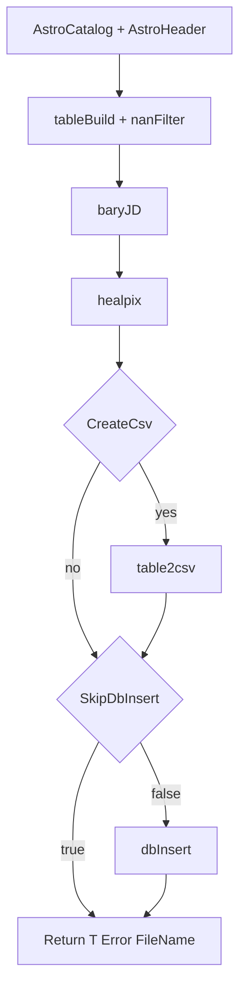

# `imProc.db.insertCatalog` call tree and overhead

Reference for LAST proc ingest: what happens inside catalog insert besides (or before) ClickHouse, and how perf flags map to work.

See also [astro_catalog_header_read_path.md](astro_catalog_header_read_path.md) (FITS read before insert) and [logging.md](logging.md) (perf log lines).

## Caller chain (proc archive perf)

```text
insertArchiveCatalogs2DB_perf
  ├─ readAstroCatalog / readAstroHeader / keywordPrep   (outside insertCatalog)
  └─ imProc.db.insertCatalog_perf   (UseInsertCatalogPerf=true, default in perf clone)
        └─ same stages as insertCatalog + stage perfLog lines
```

Production cron path uses `insertArchiveCatalogs2DB` → `imProc.db.insertCatalog` (no stage logging).

## Stages inside `insertCatalog` / `insertCatalog_perf`

| Stage | Code region | Main callees | Notes |
|-------|-------------|--------------|--------|
| **tableBuild** | Per-object loop + concat + NaN filter | `AstroCatalog.Table`, header `getVal`, column select/rename, `KeyID`, `ID_PROC_SRC` | Sub-buckets **hdr/id/sel/concat/nan** in [insertCatalog_tableBuild.md](insertCatalog_tableBuild.md) |
| **nanFilter** | (included in tableBuild timing in `_perf`) | Row delete on NaN JD/RA/Dec | Reduces row count vs in-memory Cat sum |
| **baryJD** | If `ColBJD` nonempty | `celestial.time.barycentricJD`, optional `BARYVEL` | Vectorized over full `T` |
| **healpix** | Always (default levels) | `db.util.insertHealpixIndex2table` | Adds UPIX_* columns |
| **csv** | If `CreateCsv=true` | `db.Db.table2csv` | **Legacy** proc path; **native** perf uses `CreateCsv=false` |
| **dbInsert** | If `DbTable` set and `~SkipDbInsert` | **native:** `Db.insert` in batches (`MaxBatchLines`); **legacy:** `Db.insertCsv` | Client-side timer; CH merges are async |



## Native vs legacy (`DBConnector`)

| | **native** (perf default) | **legacy** |
|--|---------------------------|------------|
| CSV | Usually `CreateCsv=false` | `CreateCsv=true`, file then `insertCsv` |
| Insert | In-memory batches → `ClickHouseClient.insert` | CSV → Java `insertCsv` |
| Disconnect | `DB.delete` at end of visit job | `disconnectCH_Java` |

## Perf flags (LAST `insertArchiveCatalogs2DB_perf`)

| Flag | Effect |
|------|--------|
| **`SkipInsert=true`** | Never call `insertCatalog` / `insertCatalog_perf`; log `SKIP insertCatalog`. Measure FITS read + prep only. |
| **`SkipInsert=false`, `SkipDbInsert=true`** | Run full table build, BJD, healpix, optional CSV; **no** ClickHouse write. Stage lines in log; `insertCatalog` density stats still from returned `T`. |
| **`SkipInsert=false`, `SkipDbInsert=false`** | Full path including CH insert into `DbTable` (e.g. `last_perf.proc_src_perf`). |

Shell: `MEASURE_SKIP_DB_INSERT=1` → MATLAB `'SkipDbInsert',true` (see [hosts_and_matlab.md](hosts_and_matlab.md)).

## Log lines (`insertCatalog_perf`)

When `PerfLogFcn` is `@pipeline.last.insertDB.perfLog` and `PerfContext` is the visit `DataDir`:

```text
insertArchiveCatalogs2DB_perf insertCatalog_perf tableBuild nRows=123456 /bigdata2/.../proc/000224v0 9.2s
insertArchiveCatalogs2DB_perf insertCatalog_perf tableBuildDetail nCat=480 nRows=123456 hdr=0.4s id=0.2s sel=1.1s concat=7.2s nan=0.3s /bigdata2/.../proc/000224v0
insertArchiveCatalogs2DB_perf insertCatalog_perf baryJD nRows=123456 /bigdata2/.../proc/000224v0 0.8s
insertArchiveCatalogs2DB_perf insertCatalog_perf healpix nRows=123456 /bigdata2/.../proc/000224v0 0.3s
insertArchiveCatalogs2DB_perf insertCatalog_perf dbInsert nRows=123456 /bigdata2/.../proc/000224v0 2.1s
```

Or `SKIP insertCatalog_perf dbInsert ...` when `SkipDbInsert=true`.

Outer visit timer still logs `insertCatalog fieldId=... nRows=... secPer100k=...` (wall time for the whole `_perf` call).

## Interpreting overhead

- Compare **`visitInsert`** (full `_perf` call) with **`SkipDbInsert=1`** vs **`0`** on the same night to bound CH client cost.
- Use stage lines to see whether **baryJD** or **healpix** dominates non-CH time.
- **`secPer100k`** on the outer line includes all stages; only **`dbInsert`** stage isolates CH send time (native batches).
