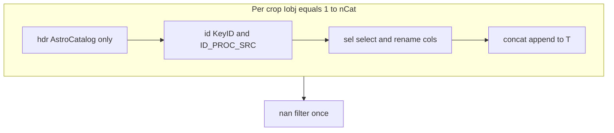

# `insertCatalog_perf` tableBuild breakdown

Reference for the **`tableBuild`** stage inside [`imProc.db.insertCatalog_perf`](../../+imProc/+db/insertCatalog_perf.m). Parent context: [insertCatalog_call_tree.md](insertCatalog_call_tree.md).

LAST proc ingest passes an **`AstroCatalog`** vector (~480 crops) plus matching **`AstroHeader`**. FITS read and MEX parse happen earlier in `insertArchiveCatalogs2DB_perf`; **tableBuild** only assembles one wide table for BJD / healpix / ClickHouse.

## What `tableBuild` includes

One wall-clock timer from the start of the per-crop loop through the **NaN JD/RA/Dec** row delete. Logged as:

```text
insertArchiveCatalogs2DB_perf insertCatalog_perf tableBuild nRows=... /path/... 9.2s
```

Sub-buckets (accumulated over all crops, one detail line per visit):

| Bucket | Code (AstroCatalog path) | Typical cost |
|--------|---------------------------|--------------|
| **hdr** | `Tmp = Table`; `getVal` + `repmat` for `NODENUMB`, `MOUNTNUM`, `CAMNUM`, optional `INGESTION_TIME_JD` | Usually small (header lookups × 480) |
| **id** | `KeyID` from header (`getVal`, optional `generateImageID`); `repmat` onto `Tmp`; `ID_PROC_SRC` sequence | Small unless many `generateImageID` calls |
| **sel** | `upper` variable names; column subset vs `ColNameDic`; rename to `ColNameOut` | Moderate (table copy/subset per crop) |
| **concat** | `T = Tmp` first crop; else `T = [T; Tmp]` | Often **dominant** — growing `table` concat copies all prior rows each iteration (~O(n²) work over a visit) |
| **nan** | Delete rows with NaN JD, RA, or Dec | Usually small vs **concat** on large visits |

**AstroImage** path: no **hdr** bucket; **id** includes header ID resolution before **sel**.



## Detail log line

When `PerfLogFcn` is set (LAST perf uses `@pipeline.last.insertDB.perf.perfLog`), one extra line per visit — **no** per-crop lines, **no** second duration suffix (seconds are inside the message):

```text
insertArchiveCatalogs2DB_perf insertCatalog_perf tableBuildDetail nCat=480 nRows=211586 hdr=0.4s id=0.2s sel=1.1s concat=7.2s nan=0.3s /bigdata2/.../proc/215616v0
```

- **nCat** — `numel(Obj)` (catalog/crop count).
- **nRows** — row count **after** **nan** (same as following `tableBuild` line).
- Sum **hdr+id+sel+concat+nan** ≈ **tableBuild** wall time (small drift from timer overhead is normal).

## Overhead

- When **`PerfLogFcn` is empty**, sub-stage timers are **not** run (same cost as calling `insertCatalog`).
- When logging is on: a few **`tic`/`toc`** per crop (~1920 calls for 480×4 buckets) — negligible vs table concat; **one** extra `fopen`/`fprintf`/`fclose` for `tableBuildDetail` per visit.

## Interpreting ~9s tableBuild

1. If **concat** is most of the total, optimization targets are batching concat (e.g. preallocate or cell + single `vertcat`) — not FITS I/O.
2. If **sel** is large, review `ColNameDic` width and per-crop column copies.
3. Compare **tableBuildDetail** across euclid vs WRX only when **`SkipDbInsert=1`** or insert path is identical; NFS does not affect in-memory table build after catalogs are loaded.

## Related

- [logging.md](logging.md) — log file format
- [astro_catalog_header_read_path.md](astro_catalog_header_read_path.md) — time before `insertCatalog_perf`
